# Как запустить ЛюсиЧат

Программа для Windows. Читает чат эфира, говорит голосом и может ответить Люси в чат Twitch. Голос и модель качаются один раз и остаются на компьютере.

Сайт: [ghostpot.ru](https://ghostpot.ru)

## 1. Скачай и запусти

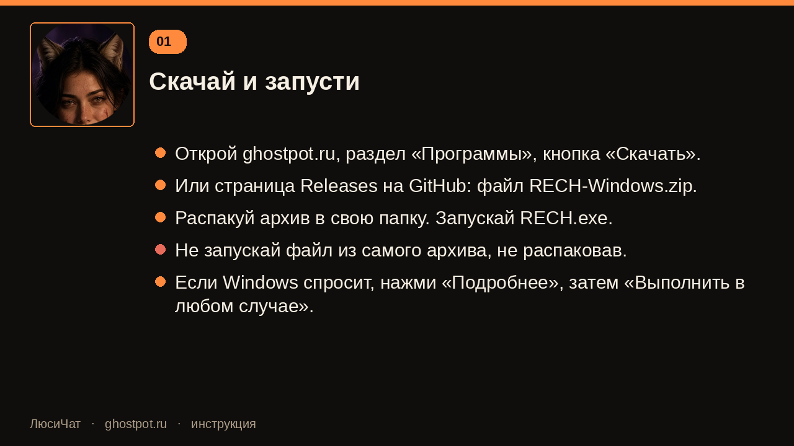

Кнопка на сайте ведёт на [последний выпуск](https://github.com/Ghostpot/LucyChat/releases/latest). Файл называется `RECH-Windows.zip`. Распакуй его и запусти `RECH.exe`.

## 2. Скачай голос и Люси

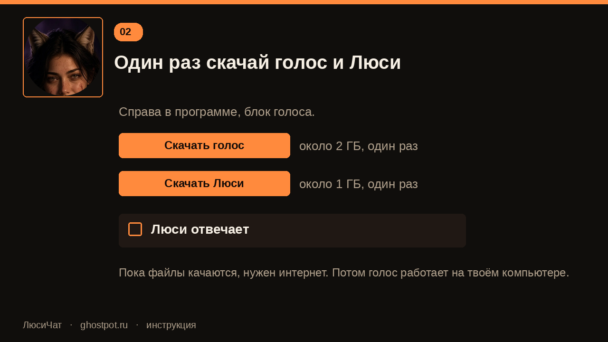

«Скачать голос» — около 2 ГБ. «Скачать Люси» — около 1 ГБ. Оба раза нужен интернет. Потом включи «Люси отвечает».

## 3. Подключи свой канал

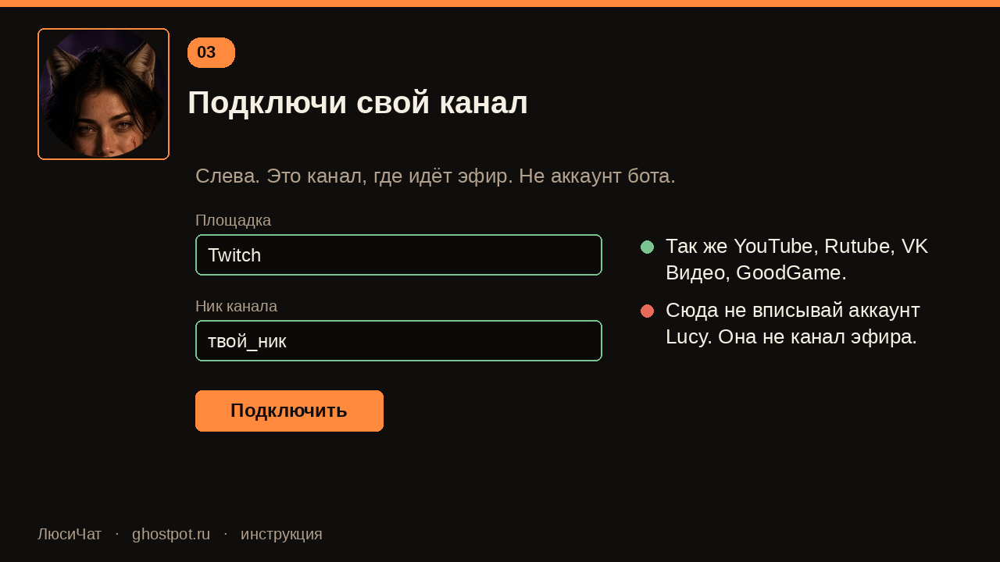

Слева выбирается площадка и ник **твоего** канала. Туда же можно добавить YouTube, Rutube, VK Видео и GoodGame. Аккаунт Lucy сюда не вписывается.

## 4. Покажи чат в OBS

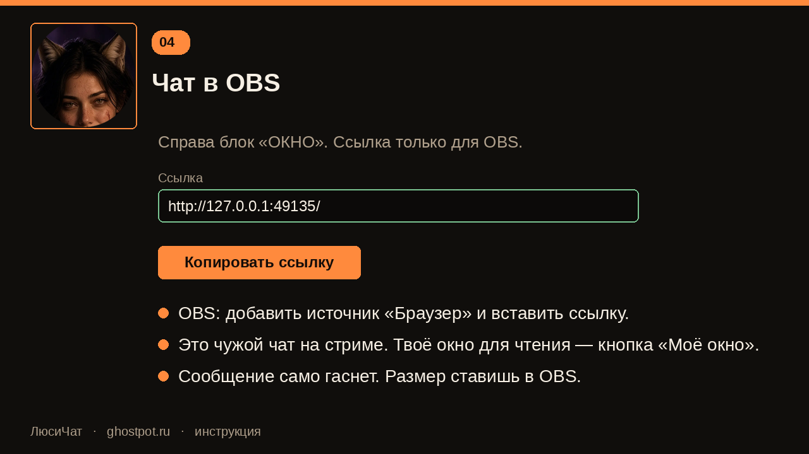

Справа в блоке «ОКНО» скопируй ссылку. В OBS добавь источник «Браузер» и вставь её. Это картинка для зрителей. Своё окно, где ты читаешь чат, открывается кнопкой «Моё окно».

## 5. Сделай приложение на Twitch

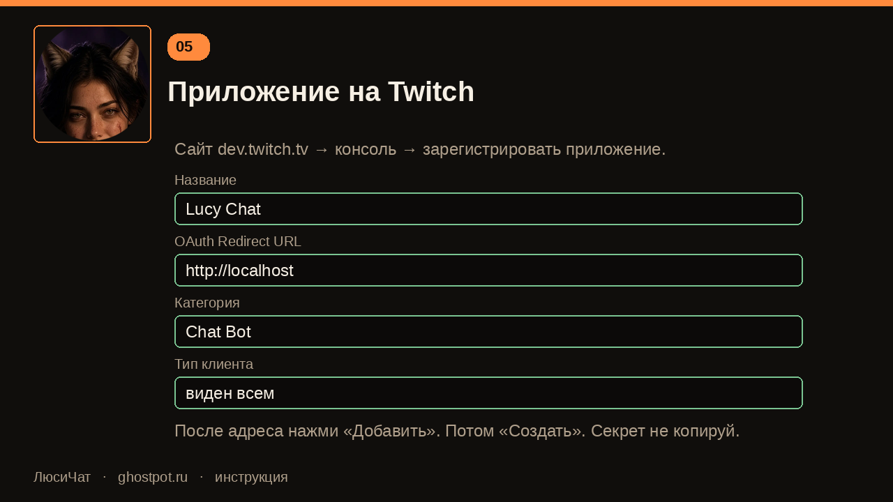

Зайди на [dev.twitch.tv](https://dev.twitch.tv/console/apps) своим аккаунтом и зарегистрируй приложение.

- Название латиницей, без двоеточия. Подойдёт `Lucy Chat`. Русские буквы Twitch не принимает.
- OAuth Redirect URL: `http://localhost`, затем кнопка «Добавить».
- Категория: Chat Bot.
- Тип клиента: **виден всем**.
- Секрет не копируй. Он программе не нужен.

## 6. Не перепутай два кода

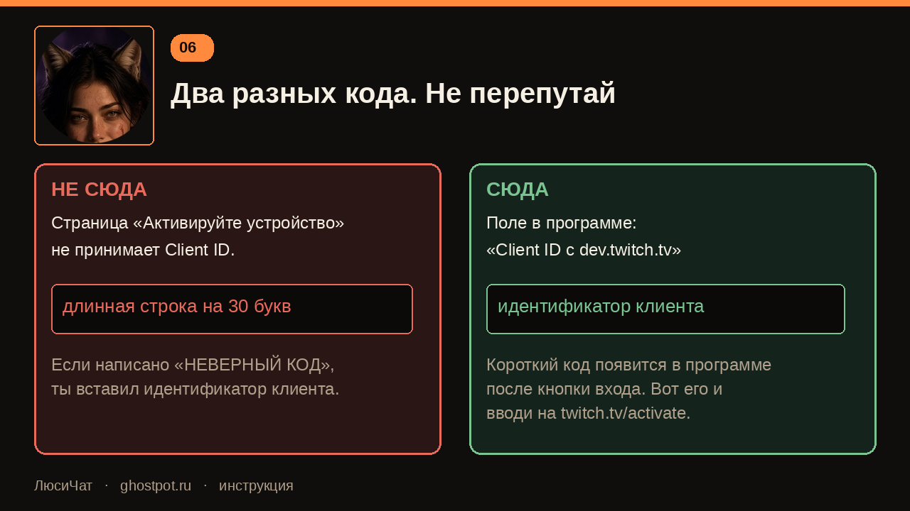

**Идентификатор клиента** — длинная строка. Она вставляется только в поле программы «Client ID с dev.twitch.tv».

**Короткий код** появляется в программе после кнопки входа. Его вводишь на [twitch.tv/activate](https://www.twitch.tv/activate). Если страница пишет «неверный код», в неё попал идентификатор клиента.

## 7. Войди как Lucy

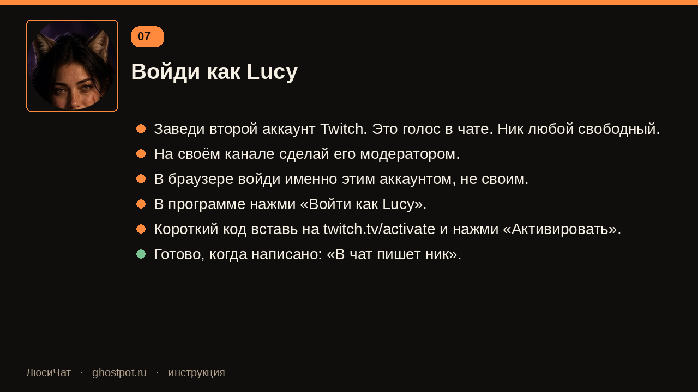

Нужен второй аккаунт Twitch. Ник любой свободный: в чате будет написано именно он. На своём канале сделай этот аккаунт модератором.

В браузере зайди **этим** аккаунтом. В программе нажми «Войти как Lucy» и введи короткий код. Готово, когда строка говорит: «В чат пишет ник».

## 8. Войди для наград

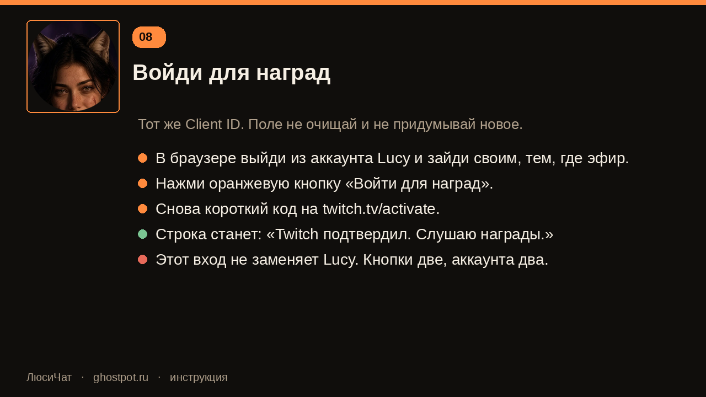

Тот же Client ID. В браузере уже зайди **своим** аккаунтом, тем, на котором эфир. Нажми «Войти для наград» и снова введи короткий код. Строка должна стать: «Twitch подтвердил. Слушаю награды.»

Это второй вход. Он не заменяет Lucy.

## 9. Создай две награды

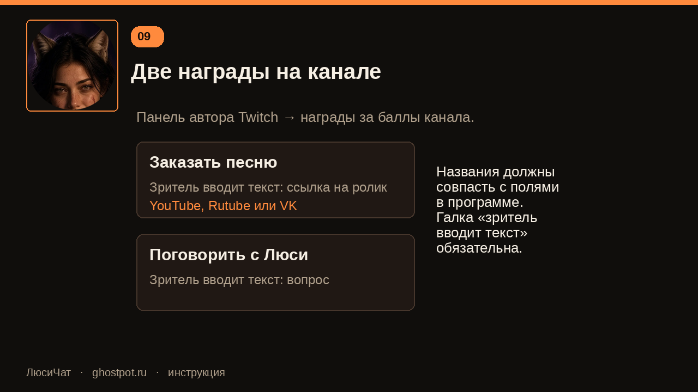

В панели автора: награды за баллы канала. Две штуки, у обеих галка «зритель вводит текст».

- «Заказать песню» — человек вставляет ссылку на YouTube, Rutube или VK.
- «Поговорить с Люси» — человек пишет вопрос.

Названия должны совпасть с полями в программе. Их можно переименовать, но тогда одинаково в обоих местах.

## 10. Песня отдельным окном

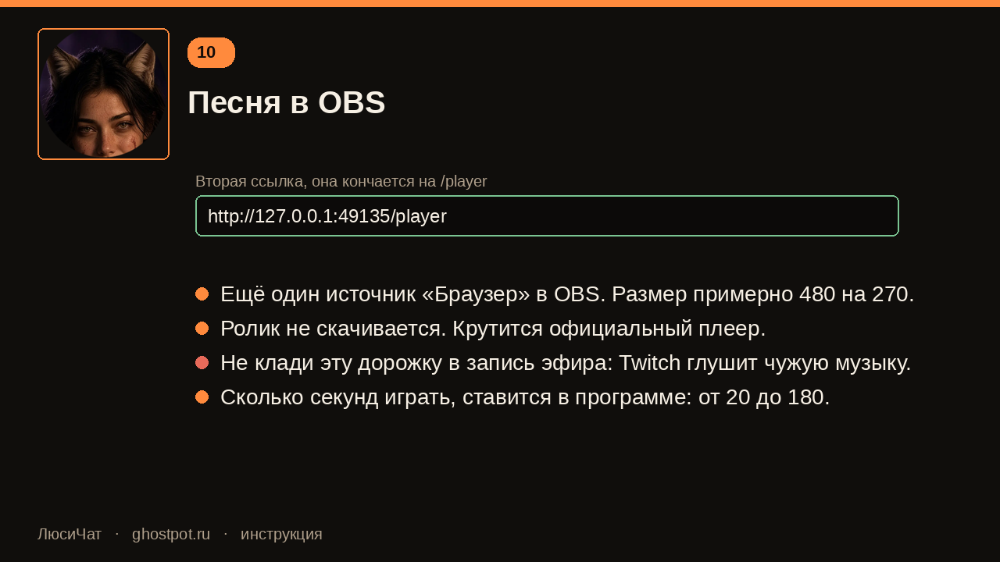

Вторая ссылка кончается на `/player`. Её тоже вставь в источник «Браузер», размер примерно 480×270. Ролик не скачивается, играет официальный плеер. Чужую музыку не клади в дорожку записи: Twitch такие записи глушит.

## 11. Что увидит чат

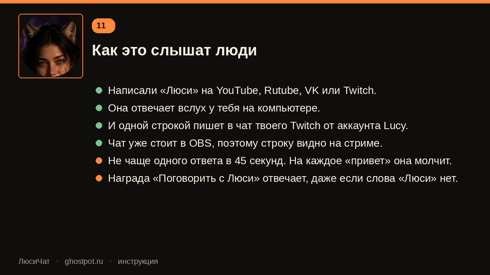

Написали «Люси» на любой подключённой площадке — она говорит вслух и одной строкой пишет в чат твоего Twitch. Чат уже стоит в OBS, поэтому строку видно на стриме. Чаще раза в 45 секунд она не отвечает.

Награда «Поговорить с Люси» срабатывает и без слова «Люси» в вопросе.
